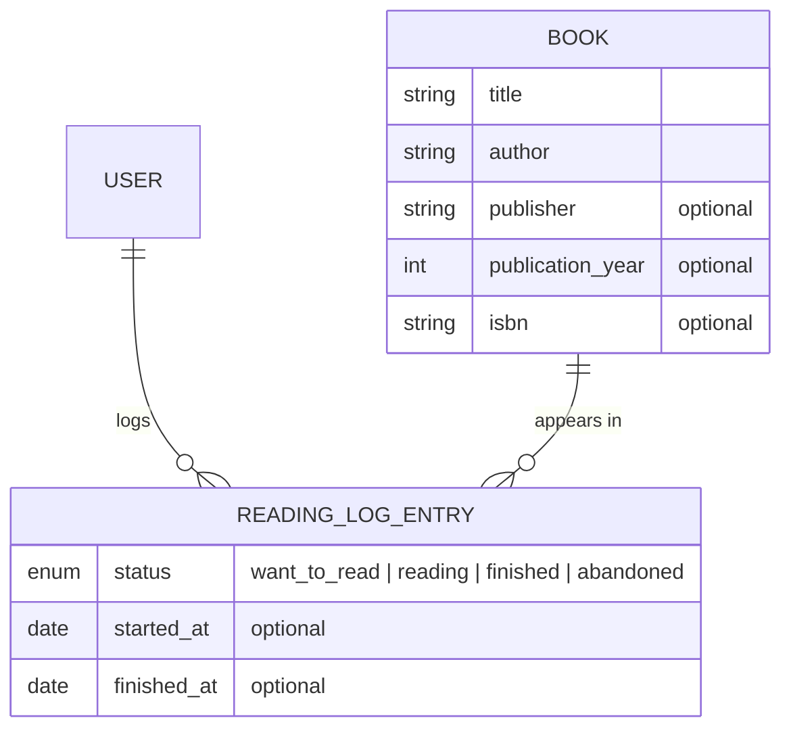

# 📚 Reading List

<!-- One-line tagline -->
A simple way to track the books you're reading.

[](https://github.com/vanesarobledo/reading-list/actions/workflows/tests.yml)


**🔗 Live app:** https://reading-list.vehikl.cloud/

<!-- Screenshot (when UI is finished)

-->

---

## Table of contents

- [📖 About](#-about)
- [🎯 Goals](#-goals)
- [✨ Features](#-features)
- [🧰 Tech stack](#-tech-stack)
- [🧱 Data model](#-data-model)
- [🚀 Getting started](#-getting-started)
- [🧪 Running tests](#-running-tests)
- [📋 Adding a feature](#-adding-a-feature)
- [🗺️ Roadmap](#️-roadmap)
- [📄 Project docs](#-project-docs)

---

## 📖 About

**Reading List** is a simple way for technical professionals to track the books they read.

Having a strong grasp of the fundamentals, including software architecture, algorithms, patterns, is important to engineering good code in the age of AI development. The best source of this knowledge is reading the classics, and Reading List gathers them all in one place.


## 🎯 Goals

This is a deliberate-practice project. The main goals are to:

- Practice basic Laravel CRUD operations until I can do it in my sleep
- Practice test-driven development
- Practice Git by creating feature branches, linking issues, responding to code review, and merging
- Practice deploying an actual app
- Work on coding something by hand rather than AI

## ✨ Features

### ✅ To Deployment (deployed 2026-10-20)

- [x] User can add a book
- [x] User can search books
- [x] User can add a book to their reading list
  - Users can add a book more than once: reading, re-reading, etc.
- [x] User can view their reading log

### 🚧 After Deployment

- [x] User can delete a reading log entry
- [x] User can update their reading log entry
- [ ] User can view other users' reading log profiles
- [ ] User can sort their reading log: reverse-chronological, alphabetical, etc.
- [ ] User can add tags to their reading log entry
  - [ ] Users can sort/filter by tags

## 🧰 Tech stack

| Layer    | Tools                                                                                                |
| -------- | ---------------------------------------------------------------------------------------------------- |
| Backend  | [Laravel 13](https://laravel.com), PHP 8.4, Laravel Fortify (auth)                                   |
| Frontend | [Vue 3](https://vuejs.org) + TypeScript, [Inertia.js](https://inertiajs.com), Laravel Wayfinder      |
| Styling  | [Tailwind CSS 4](https://tailwindcss.com), reka-ui                                                   |
| Testing  | [Pest](https://pestphp.com) (backend), [Vitest](https://vitest.dev) + Vue Testing Library (frontend) |
| Quality  | Laravel Pint, Larastan, ESLint, Prettier, Husky + lint-staged                                        |
| CI / CD  | GitHub Actions, Vehikl Cloud                                                                         |

<!-- Optional: why you picked this stack. -->

## 🧱 Data model



A **ReadingLogEntry** is one user's entry for one book. A user can have several entries for the same book, so rereads each get their own entry.

## 🚀 Getting started

### 📦 Prerequisites

- PHP 8.4+
- Composer
- Node.js + npm

### 🔧 Setup

```bash
git clone git@github.com:vanesarobledo/reading-list.git
cd reading-list

composer install
npm install

cp .env.example .env
php artisan key:generate
php artisan migrate --seed

composer run dev
```

## 🧪 Running tests

```bash
# Backend (Pest)
php artisan test

# Frontend (Vitest)
npm test

# Static analysis and linting
vendor/bin/phpstan analyse
npm run lint:check
npm run types:check
```

## 📋 Adding a feature

1. Add an issue for the feature on GitHub
2. Create a branch for the new feature
3. Create tests for the controller (_commit_)
4. Publish the branch, open a draft PR, and add "closes #" to its description
5. Write the controller method (_commit_)
6. Make the tests pass (_commit_)
7. Call the controller method in the frontend (_commit_)
8. Mark the PR ready for review
9. Get a human or AI reviewer to review the code
10. Address the review
11. Merge the feature into `main` only when CI is green

## 🗺️ Roadmap

- **To Deployment**: ✅ complete, deployed 2026-10-20
- **After Deployment**: 🚧 in progress (see [Features](#-features))
- **Frontend tests** ([#19](https://github.com/vanesarobledo/reading-list/issues/19)): test coverage for the frontend ahead of the redesign
- **UI Redesign** ([#14](https://github.com/vanesarobledo/reading-list/issues/14)): its own track alongside After Deployment

### ⏱️ Future features (no concrete plan yet)

- Connect to a book API to automatically add books, including citations
- Add other reading material
  - Journal articles
  - Online articles
- Display books with covers
- Add notes about books
- Statistics about books: how many people added it to their reading list

## 📄 Project docs

Specs and design decisions live in [`docs/`](docs):

- [Schema decisions](docs/reading-list-schema-decisions.md) (currently outdated)
- [Delete a reading log entry spec](docs/delete-reading-log-entry-spec.md)
- [Update a reading log entry spec](docs/update-reading-log-entry-spec.md)
- [Vitest test plan](docs/vitest-test-plan-spec.md)

---

_Built by [Vanesa Robledo](https://github.com/vanesarobledo)._
